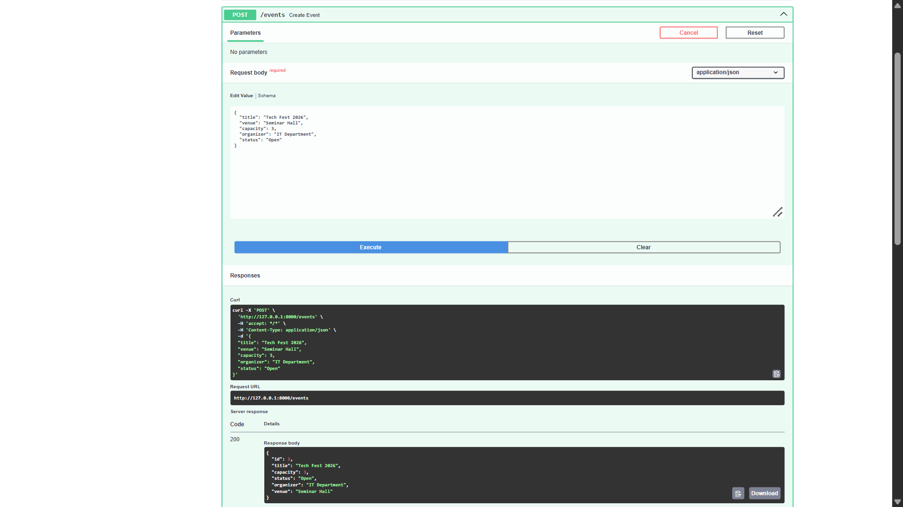
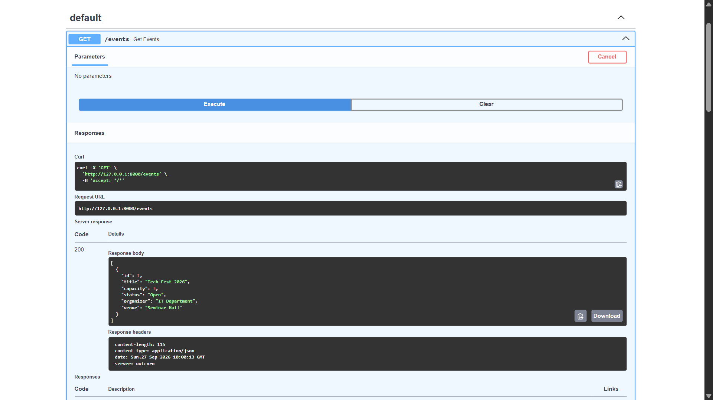
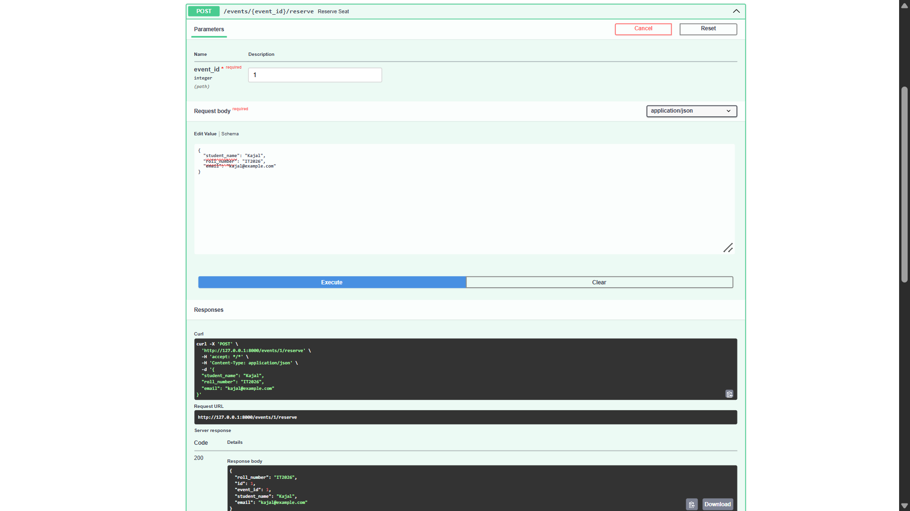
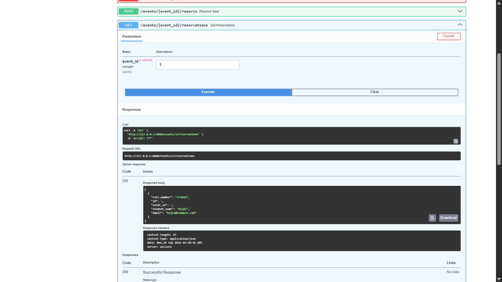
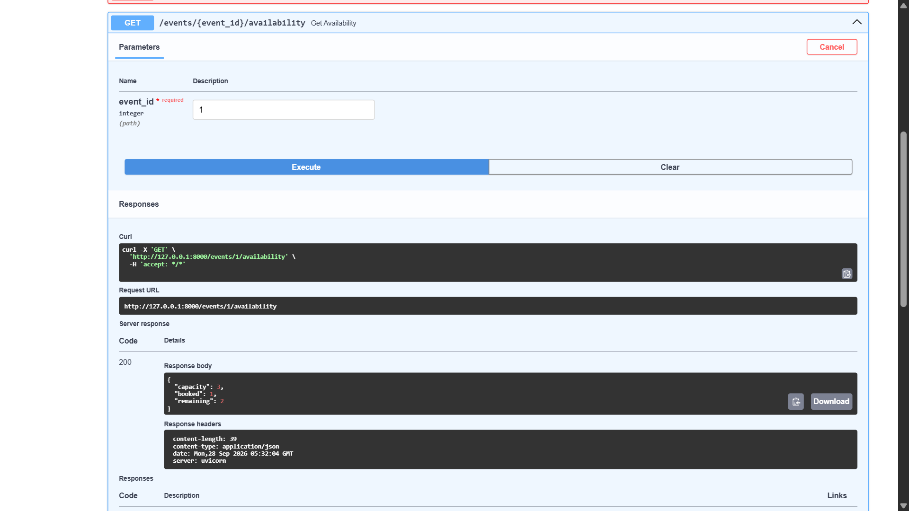
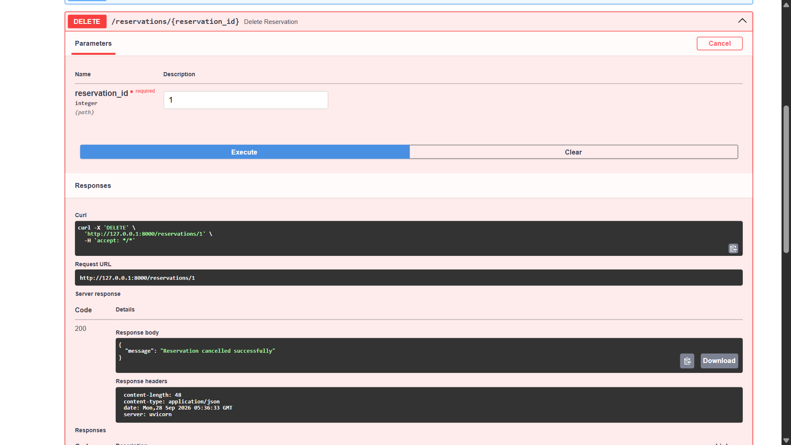
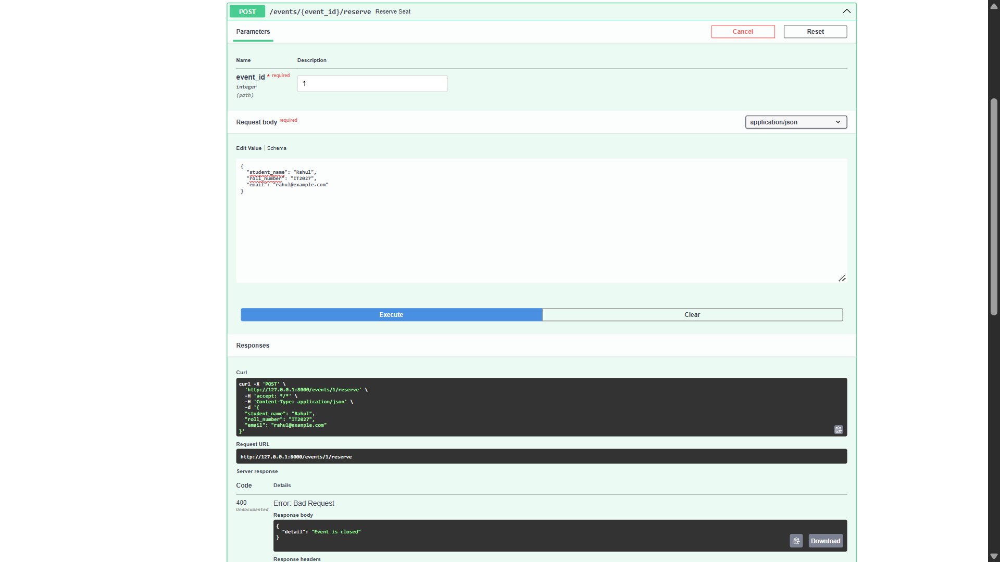

# Event Reservation API

## Project Description

This project is a REST API for managing college events and student reservations.

The API allows users to create, view, update and delete events. Students can reserve seats for open events, check event reservations, check seat availability and cancel their reservations.

The API also prevents overbooking and does not allow reservations for closed events.

## Technologies Used

* Python
* FastAPI
* SQLModel
* SQLite
* Pydantic
* Uvicorn

## Installation

Create and activate a virtual environment:

python -m venv venv

venv\Scripts\activate

Install the required packages:

pip install -r requirements.txt

## Run the Application

Start the FastAPI server using:

uvicorn main:app --reload

The application will run at:

[http://127.0.0.1:8000](http://127.0.0.1:8000)

## Swagger Documentation

Swagger UI is available at:

[http://127.0.0.1:8000/docs](http://127.0.0.1:8000/docs)

Swagger UI can be used to test all the API endpoints.

## API Endpoints

### Event APIs

POST /events — Create a new event.

GET /events — Return all events.

GET /events/{event_id} — Return a specific event.

PUT /events/{event_id} — Update event information.

DELETE /events/{event_id} — Delete an event.

### Reservation APIs

POST /events/{event_id}/reserve — Create a reservation for an event.

Before creating a reservation, the API checks whether the event exists, whether the event is Open, and whether seats are available.

GET /events/{event_id}/reservations — Return all reservations for a particular event.

DELETE /reservations/{reservation_id} — Cancel a reservation.

GET /events/{event_id}/availability — Return total capacity, booked seats and remaining seats.

Example response:

{
"capacity": 50,
"booked": 32,
"remaining": 18
}

## Validation and Business Logic

* Event capacity must be greater than 0.
* Student name must not be empty.
* Email is validated using Pydantic EmailStr.
* A reservation must reference an existing event.
* Reservations are allowed only when the event status is Open.
* Existing reservations are counted before creating a new reservation.
* A reservation is rejected when the event has reached its capacity.
* The API prevents an event from exceeding its defined capacity.
* Event availability shows total capacity, booked seats and remaining seats.
* A 404 error is returned when an event or reservation does not exist.

## Database

SQLite is used as the database.

SQLModel is used for defining the database models and performing database operations.

The database engine is created using create_engine().

When the FastAPI application starts, the required database tables are automatically created.

The database file is event_reservation.db.

## Screenshots

### POST /events

### GET /events

### Successful Reservation

### GET Event Reservations

### Event Availability

### Successful Reservation Cancellation

### Unsuccessful Reservation for Closed Event

## Challenges Faced / Additional Comments

Understanding and implementing the reservation business logic, especially checking event capacity, preventing overbooking, and handling reservations for closed events.

